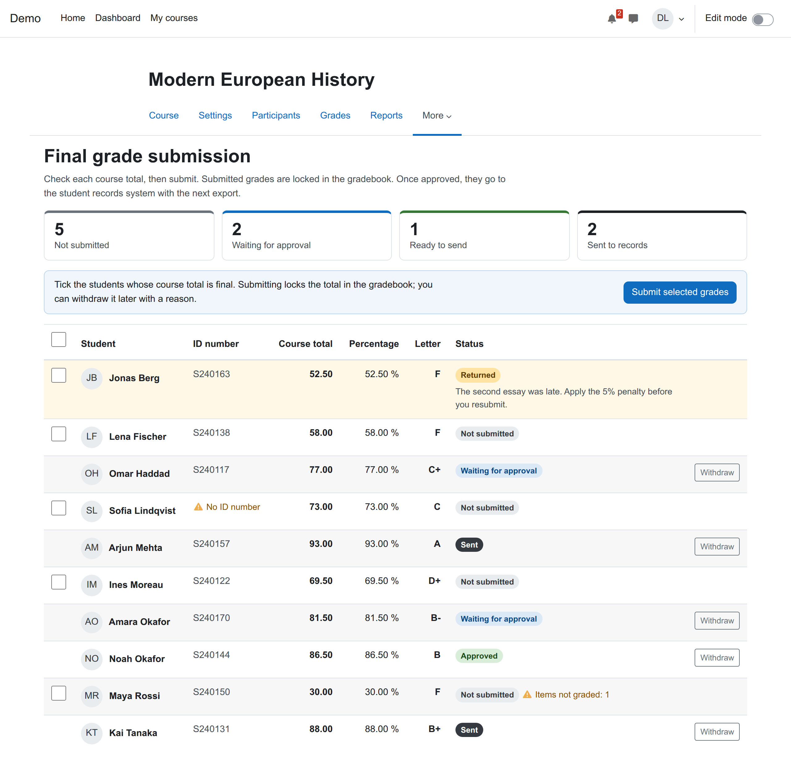
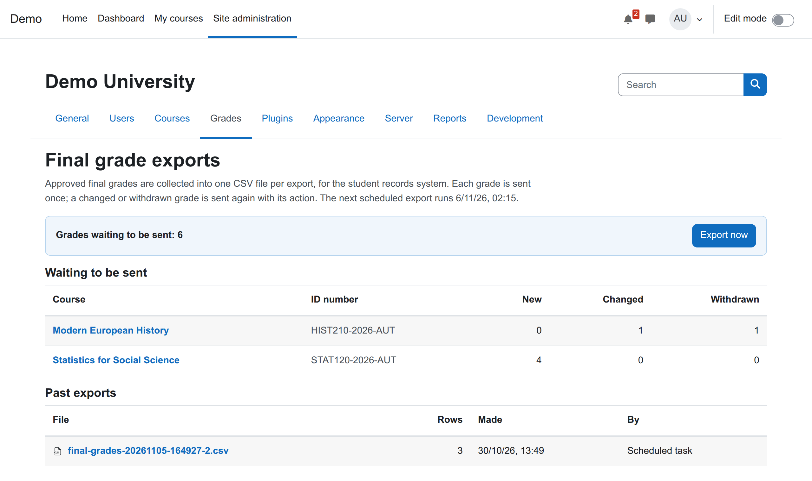
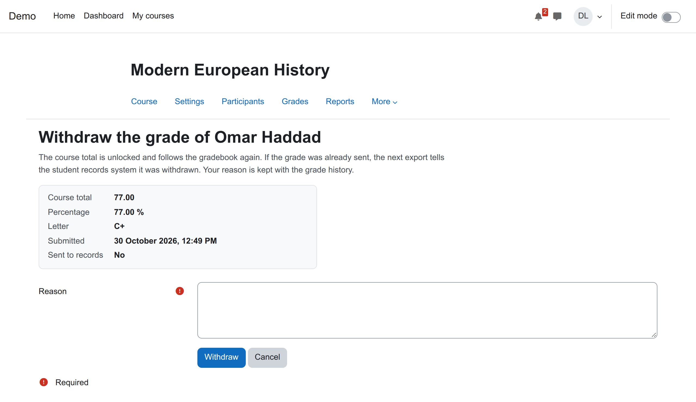

# Final grade submission for Moodle (local_finalgrades)

[](https://github.com/devlms/moodle-local_finalgrades/actions/workflows/ci.yml)
[](https://devlms.github.io/moodle-local_finalgrades/)
[](https://devlms.github.io/moodle-local_finalgrades/php-coverage/)
[](https://moodledev.io/general/releases)
[](https://www.php.net/supported-versions.php)
[](LICENSE)
[](version.php)

Teachers check each student's course total and submit it. Submitted totals are locked in the gradebook, so a late change to an activity cannot move them. An approver can sign them off first if your school wants that. Every night the grades waiting to be sent go into one CSV file for the student records system: new grades, changed grades and withdrawn ones, each marked as such.

Most schools that run Moodle do this step by hand. The teacher exports the gradebook, someone cleans the spreadsheet, and the registrar uploads it to Banner, SITS or whatever the records system is. Each university builds its own version of a "submit final grades" button. This is a general one.



## What it does

| Part | Status |
| --- | --- |
| A "Final grades" page in each course: course total, percentage and letter per student, from the course's own letter boundaries | Done |
| Warnings before you submit: items not graded yet (Moodle leaves them out of the total), no student ID number, no course ID number | Done |
| Submit all or some students. The submitted total is stored and locked in the gradebook | Done |
| Withdraw a submitted grade with a reason. The total is unlocked; the reason stays in the history | Done |
| Optional approval: a head of department, given the approve permission in a category, approves or returns grades with a reason | Done |
| Nightly CSV export of grades waiting to be sent, stored in Moodle for download. Each grade is sent once | Done |
| A changed grade is sent again as `change`; a sent grade that is withdrawn is sent as `withdrawn` | Done |
| Optional drop folder on the server for a job that loads the file into the records system | Done |
| Log events for every submission, approval, return, withdrawal and export. Privacy API export and delete | Done |
| Push to a records system API (SITS, Banner, PowerSchool), SFTP upload, per-course columns | Not in this plugin: [we build these](https://devlms.com/#quote) |



## The export file

One CSV file per export, UTF-8, comma separated, one header line:

| Column | Example | Notes |
| --- | --- | --- |
| `action` | `new` | `new`, `change` (sent before with a different grade) or `withdrawn` |
| `course_idnumber` | `HIST210-2026-AUT` | The course ID number when the grade was submitted |
| `course_shortname` | `HIST210` | |
| `student_idnumber` | `S240117` | The student's ID number when the grade was submitted |
| `student_name` | `Omar Haddad` | |
| `grade` | `77.00` | Course total, two decimals, dot separator |
| `percentage` | `77.00 %` | |
| `letter` | `C+` | From the course's letter boundaries |
| `submitted_by` | `Hana Lee` | |
| `submitted_at` | `2026-10-30T12:46:00Z` | UTC |

If a grade is withdrawn and submitted again before the next export, the file has one `change` line for it, not two.

## Install

Needs Moodle 4.5 to 5.3.

1. Download the zip from [Releases](https://github.com/devlms/moodle-local_finalgrades/releases) and install it under Site administration, Plugins, Install plugins. Or clone it:

   ```bash
   # Moodle 4.5 and 5.0
   git clone https://github.com/devlms/moodle-local_finalgrades.git local/finalgrades
   # Moodle 5.1 and later
   git clone https://github.com/devlms/moodle-local_finalgrades.git public/local/finalgrades
   ```

2. Visit Site administration, Notifications to finish the install.
3. Settings are under Site administration, Plugins, Local plugins, Final grade submission. The exports page is under Site administration, Grades, Final grade exports.
4. Teachers find "Final grades" in the course menu (under More).

The scheduled task "Export final grades for the student records system" runs at 02:15 every night. Change it under Site administration, Server, Scheduled tasks.

The drop folder is a path on the Moodle server. To stop it being changed from the web, set it in `config.php`:

```php
$CFG->forced_plugin_settings['local_finalgrades'] = ['dropfolder' => '/srv/sis/inbox'];
```

## Permissions

| Capability | Default roles | Allows |
| --- | --- | --- |
| `local/finalgrades:submit` | Teacher, manager | Submit and withdraw a course's final grades |
| `local/finalgrades:approve` | Manager | Approve or return submitted grades. Give it to a head of department in a course category |
| `local/finalgrades:export` | Manager | See the exports page, export now and download the files |



## Privacy

A student's data request covers every grade submitted for them, with its history and reasons. A teacher's or approver's request covers what they submitted, approved, returned or withdrew. Deleting a teacher's data keeps the grades without their name, because the grade is the student's record. Export files are copies of what was sent to the student records system and are kept.

## Tests

PHPUnit covers the gradebook lock (a late item change does not move a submitted total, withdrawing lets it move again), submission, approval and return, the export file and its actions, the drop folder, the page data and the privacy provider. Behat walks a teacher through submitting and withdrawing and a registrar through an export, with Moodle's accessibility checks on every page. CI runs on Moodle 4.5 to 5.3 with PostgreSQL and MariaDB: [reports](https://devlms.github.io/moodle-local_finalgrades/).

## Works with Autoflow

Every action is a Moodle event, so [Autoflow](https://github.com/devlms/moodle-tool_autoflow) can start a workflow from it: tell the registrar when a course is fully submitted, or post the export to an API once it is made.

## Who made it

[DevLMS](https://devlms.com) builds custom Moodle plugins. Need this connected to your records system, or a different plugin? [Get a quote](https://devlms.com/#quote).

## License

GNU GPL v3 or later.
